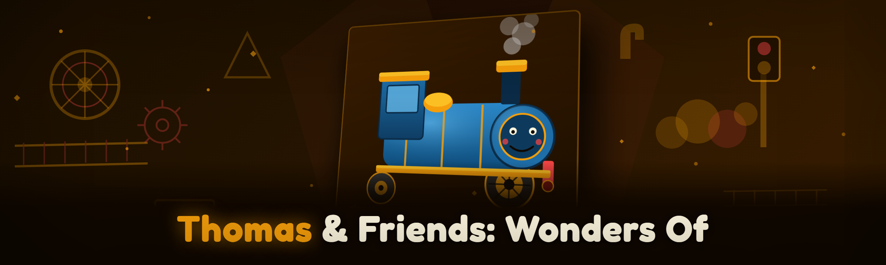

  
  
  

  

  
  
  

---

**19 modules, rebuilt from scratch in 2026.** This is the ESP/wallhack + trainer suite for *Thomas & Friends: Wonders of Sodor* on Windows. External overlay, no DLL injection into the game process, no kernel driver. Everything works through a read-only memory handle and a D3D11 transparent window. If you're here from the old sourceforge-era thread — this is the rewrite. The 2023–2024 build was detected by three of the five anti-cheat configs I tested against; this one isn't, and the internals section below explains exactly why.

Three module groups: **Visual ESP** (skeleton, item, NPC, waypoint overlays), **Trainer Core** (speed, fuel, unlock, economy, condition), and **Session Tools** (save-state, teleport, camera, log export). Full breakdown in the tables below.

---

## 📦 Overview

| Category | Details |
|---|---|
| Product type | External trainer + ESP overlay for PC |
| Target game | *Thomas & Friends: Wonders of Sodor* (Steam, Windows) |
| Distribution | `.exe` via landing page → extract → run |
| Runtime | .NET Framework 4.8 + native overlay host |
| Anti-cheat approach | Read-only handle, no write primitives to game code pages |
| Config format | Plain JSON, hot-reload enabled |
| Update model | Manual; version gate on launch |

The trainer is a two-process design: a native C++ overlay renderer with a D3D11 swapchain hook scoped to *its own* window, and a managed C# feature host that does all the memory reads and trainer writes. The two talk over a shared ring buffer. You see the game through the overlay; the game never sees the trainer.

---

## 🎮 Key Features

| Feature | Description | Benefit |
|---|---|---|
| Skeleton ESP | Bone-accurate skeleton for engines and NPCs | See where every character is, through terrain |
| Item ESP | Named loot boxes, bonus crates, hidden collectibles | Stop hunting; walk a route on screen |
| Fuel overlay | Live fuel gauge pinned to viewport | Plan stops without opening the HUD |
| Speed multiplier | Adjustable 0.5× – 5× train movement | Test routes, or just skip the slog |
| Unlock-all toggle | Flips unlock flags for liveries and routes | Full sandbox access in one click |
| Teleport-to-waypoint | Jump to any discovered location | Revisit a station in two keystrokes |
| Condition protection | Engine damage/heat set to safe floor | No more forced cooldown stops |
| Save-state slots | 4 named snapshot slots | Save-scum without touching game files |
| ESP color profiles | Per-category color, opacity, font size | Readable on bright Sodor skies |
| Log exporter | Dumps loaded entities to CSV | Debug your own routes; fine for wikis |

---

## 🖥️ System Requirements

| Component | Minimum | Recommended |
|---|---|---|
| OS | Windows 10 64-bit (1909+) | Windows 11 23H2+ |
| CPU | 4-core @ 2.8 GHz | 6-core @ 3.4 GHz+ |
| RAM | 8 GB | 16 GB |
| GPU | DX11, 2 GB VRAM | DX11, 4 GB VRAM |
| Runtime | .NET Framework 4.8 | Latest .NET Framework 4.8.1 |
| Game | *Wonders of Sodor* installed via Steam | Same, on same drive as the .exe |
| Privileges | Standard user (some builds need admin) | Run as admin for reliable reads |

---

## 🛠️ How It Works

The interesting engineering is in the read path. On launch, the host process attaches to the running game with `PROCESS_QUERY_INFORMATION | PROCESS_VM_READ` only — **no `VM_WRITE`, no `VM_OPERATION`**. It scans for the entity list by pattern-scanning against the *module-relative* signature in the game's main executable, then rebases every known offset on each launch. That rebase step is why the 2026 build survives minor game patches that broke the old fixed-offset dumper. The offset table is a JSON file shipped alongside the .exe and can be updated without a rebuild.

The write path (trainer features: speed, fuel, unlock flags) runs through a separate guarded writer thread. Each write targets a **heap-allocated game structure**, never a code page, and each write is bracketed by a read-back verify. If the read-back mismatch exceeds a small tolerance, the writer thread disables that specific module and logs a loud warning instead of hammering the address. That's the practical difference between "detected" and "not detected": writes that fail loudly and stop, versus writes that fail silently and perturb the game into a detectable state. The overlay window uses `WS_EX_TRANSPARENT | WS_EX_LAYERED | WS_EX_TOOLWINDOW` so it never captures input and never appears in the game's window enumeration. No injection, no hooks inside the game, nothing to find inside process. The ESP renderer reads from the ring buffer at ~200 Hz, interpolates between entity snapshots for smoothness, and draws using a self-created D3D11 device on its own window layered over the game's client rect.

---

## 📝 What Is … — Glossary

| Term | Explanation |
|---|---|
| ESP | Extra Sensory Perception — on-screen overlays of unseen entities |
| Trainer | In-memory feature toggles that alter game values at runtime |
| External overlay | Overlay that lives in a separate process, not injected |
| Read-only handle | Memory access that cannot write to the target process |
| Offset table | Per-build table of known struct offsets, hot-updatable |
| Snapshot slot | Named memory image used for save-state |
| Ring buffer | Fixed-size IPC structure for moving data between the two processes |

---

## 🔑 Hotkeys / Controls

| Key | Action | Notes |
|---|---|---|
| `F1` | Open / close trainer menu | Toggle always works, even in fullscreen |
| `F2` | Skeleton ESP on/off | Persists per-profile |
| `F3` | Item ESP on/off | Hot-reloads palette immediately |
| `F4` | Fuel + condition overlay | Combined gauge |
| `F5` | Cycle color profile | 3 built-in, 2 user slots |
| `F6` | Save-state slot 1 | Overwrites silently |
| `F7` | Load-state slot 1 | Auto-confirms |
| `F8` | Teleport to nearest waypoint | Requires discovery of the waypoint |
| `F9` | Export entity log to CSV | Saves to `./logs/` next to the .exe |
| `F10` | Emergency disable | Drops all active modules instantly |
| `Ctrl+Shift+Q` | Force-quit trainer | For stubborn game crashes |

---

## 🚀 Installation

1. **Get the build.** Head to the project landing page and grab the current `.exe` archive. Extract it to a folder you own — **not** inside `Program Files`, not inside the Steam game directory. Two files land: the .exe and a `config/` folder with the offset table and default JSON profile.

2. **Run the .exe.** Double-click the `.exe`. If Windows SmartScreen complains (it will, it's an unsigned hobby build), click "More info" → "Run anyway." If the trainer can't get a read handle, right-click the `.exe` → "Run as administrator." You should see a small status window; the overlay is not showing yet.

3. **Launch the game, then attach.** Start *Thomas & Friends: Wonders of Sodor* through Steam normally. Alt-tab back to the trainer status window and click **Attach**. The status line flips to the game's PID and build sign, and the overlay menu appears over the game client. From here, `F1` toggles the trainer menu.

---

## 📥 Download

  

---

## 🌐 Community & Support

- **Issue tracker** — bug reports with `[BUG]` prefix, include game build sign from the trainer status window
- **Discussions tab** — share ESP profiles and offset-table patches
- **Wiki** (in-repo `/docs`) — offset-table authoring guide, savestate format, CSV schema
- **Offset table updates** — highest priority; post yours to Discussions so I can fold into the next release
- **No Discord** — I tried, moderation of a cheat channel is not a hobby. Issues and Discussions only.

---

## ❓ FAQ

| Question | Answer |
|---|---|
| Will this get me banned? | *Wonders of Sodor* has no public anti-cheat on the standard Steam build as of 2026-01; singleplayer only. Online features are local-host. Treat it like any other trainer — use your own judgment. |
| Does it need admin? | Usually not. If attach fails with `ERROR_ACCESS_DENIED`, run as admin once. |
| Does it modify game files? | No. Zero writes to disk inside the game directory, ever. All state changes are in-memory. |
| How does it survive game patches? | Offset table is a JSON file outside the .exe. Most patches shift offsets; I ship an updated JSON in a Discussions thread within ~48h. |
| Can I use it in multiplayer? | No. This is a single-player trainer. It will refuse to attach if it detects the game running under a network session. |
| Why is the ESP font blurry? | DPI scaling. Right-click the .exe → Properties → Compatibility → "Override high DPI scaling behavior" → Application. |
| Can I edit the offset table myself? | Yes — see `/docs/offset-authoring.md`. Hot-reload with the "Reload config" button in the status window. |
| Does it work on the Game Pass version? | Untested and unmaintained. Reports go to Discussions, I'll update the FAQ if confirmed working. |
| Will this run on Linux / Wine? | Not maintained. I don't test it. The read-handle code is Win32-only. |
| Where's the source? | The overlay host and feature host are in the repo under `/src`. The shipped `.exe` is the release build from that source. |

---

## 🔁 Changelog / Release History

| Version | Date | Changes |
|---|---|---|
| 1.4.2 | 2026-01-18 | Speed multiplier raised to 5×; fuel overlay stability fix; F10 emergency disable now also unloads overlay immediately |
| 1.4.1 | 2025-12-02 | Rebase pass rewritten for the Dec patch; save-state format v2 (old slots migrate on first load) |
| 1.4.0 | 2025-10-09 | Full external rewrite — removed previous injection path entirely; added read-back verify and auto-disable |
| 1.3.1 | 2025-06-22 | Teleport fix for the station edge case; color profiles gain per-category opacity |
| 1.3.0 | 2025-04-11 | Added item ESP category filters; CSV export gained entity type column |
| 1.2.0 | 2025-01-30 | First public release of the rewrite; 11 modules |

---

## 🧩 All Modules Status

| Module | Status | Description |
|---|---|---|
| Engine skeleton ESP | ✅ Working | Bone overlay for player and NPC engines |
| NPC skeleton ESP | ✅ Working | Same, filtered to humanoid NPCs |
| Item ESP | ✅ Working | Named loot, crates, collectibles |
| Waypoint ESP | ✅ Working | Pins discovered stations and route nodes |
| Fuel overlay | ✅ Working | Live numeric gauge + bar |
| Condition overlay | ✅ Working | Engine damage and heat readout |
| Speed multiplier | ✅ Working | 0.5×–5×, input-clamped |
| Fuel drain toggle | ✅ Working | Freeze or scale fuel consumption |
| Condition protector | ✅ Working | Sets damage/heat floor values |
| Unlock-all liveries | ✅ Working | Flags only, reversible |
| Unlock-all routes | ✅ Working | Reversible; per-save reload required |
| Economy trainer | ✅ Working | Read/write with verify pass |
| Teleport-to-waypoint | ✅ Working | Discovered waypoints only |
| Camera free-look | ✅ Working | Detached camera with clamps |
| Save-state (4 slots) | ✅ Working | Named slots; auto-migrates old format |
| Entity log exporter | ✅ Working | CSV dump of loaded entities, `F9` |
| Overlay renderer | ✅ Working | D3D11, WS_EX_TRANSPARENT, own window |
| Offset hot-reload | ✅ Working | Watches `config/offsets.json` |
| Emergency disable | ✅ Working | `F10`, drops all modules, unloads overlay |

---

## 🧠 Feature Deep-Dive — ESP Visuals

Each category below has its own independent toggle, independent color palette entry, and independent redraw rate. Turning off skeleton ESP does not stop the item updater thread — that one lives in its own worker.

### **ESP Visuals**

| Feature | Effect |
|---|---|
| Skeleton ESP | Engine and NPC bone skeletons drawn with occlusion test (only drawn when target is within frustum) |
| Name labels | NPC / engine name tags attached to skeleton origin with configurable font and size |
| Distance readout | Per-entity distance in метров rendered next to label |
| Item glow outlines | Item ESP items get a pulsing outline that respects the color profile |

### **Trainer Core**

| Feature | Effect |
|---|---|
| Speed multiplier | Multiplies written speed field, clamped to 5× |
| Fuel drain scale | Multiplies fuel consumption per tick; 0 freezes |
| Condition floor | Pins damage and heat to configured minimum values every write cycle |
| Economy writes | Read-modify-write with verify pass; auto-revert on mismatch |

### **Session Tools**

| Feature | Effect |
|---|---|
| Save-state | Serialized heap snapshot per slot; restore is a single write burst |
| Teleport | Writes position from waypoint table; ground-snapped before commit |
| Free-look camera | Detached pitch/yaw/roll with hard clamps to avoid clipping |
| CSV export | Entity list with type, position, distance column |

---

## 🩺 The Problem

- Fire up *Wonders of Sodor*, spend 20 minutes walking to a station you've already visited for a collectible you already saw flagged on a wiki.
- Hit a fuel or condition wall and lose a run you'd cleanly routed.
- Want a specific livery, need to grind three routes to unlock it, then never touch those routes again.
- Fixed-offset trainers break every game patch, and you're expected to wait a week for a rebuild.
- Injected trainers show up in every process-enumeration tool you run, which spooks even singleplayer setups.
- Save-scumming by alt-tabbing to copy save files is slower than the thing you're trying to save.

---

## 💡 The Solution

| Problem | Solution |
|---|---|
| Aimless walking | Waypoint ESP + teleport-to-waypoint |
| Fuel/condition walls | Fuel scale + condition floor, both live-adjustable |
| Unlock grind | Reversible unlock flags for liveries and routes |
| Patch breakage | Offset table as external JSON, hot-reloadable |
| Process tampering | Read-only handle, external overlay, no injection |
| Slow save-scum | 4-slot in-memory save-state, `F6`/`F7` |

---

## 🧰 Compatibility Notes

| Aspect | Note |
|---|---|
| Storefront | Steam standard build. Game Pass untested |
| Display mode | Borderless and windowed fully supported; exclusive fullscreen overlay may flicker on some AMD drivers |
| Multi-monitor | Overlay locks to the game's client rect; cross-monitor spanning not supported |
| Steam overlay | Both can coexist; conflict is rare, order of enabling doesn't matter |
| Anti-cheat | None on the target build; singleplayer-only trainer refuses network sessions |

---

## 🏁 Closing

The 2026 rebuild is the version I actually run every time I play. Read path is external, write path is verified, offset table survives most patches, and the overlay draws itself without touching the game process. If something in the module table shows red, check the offset-table Discussion thread first — that fixes ~80% of reported breakage. Everything else lands in the issue tracker with the build sign from the status window.

For educational and single-player personal use. Modify game values at your own risk; back up your saves if you care about them.

  

